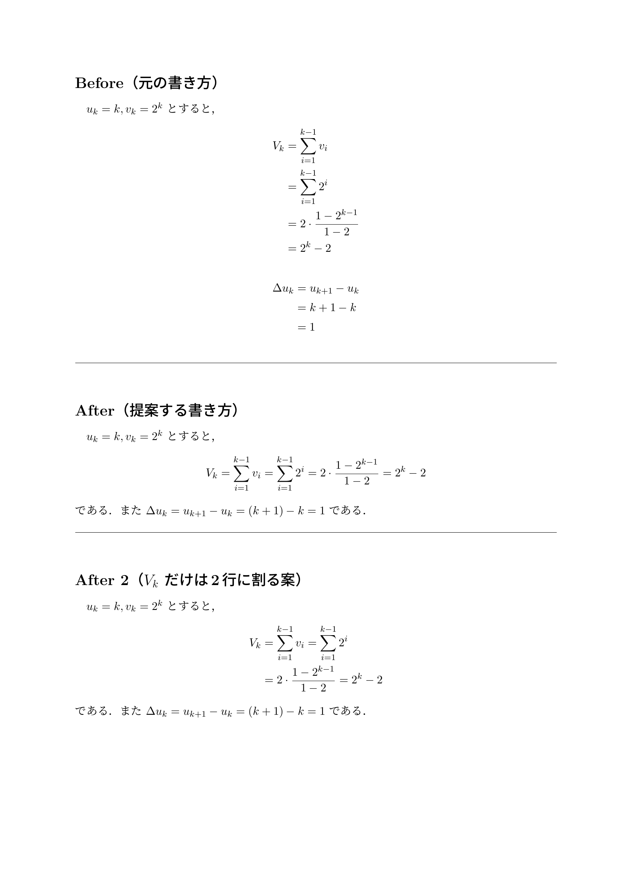

体裁についての判断を、個人の感覚で終わらせず、判例として貯めていく場所です。
「前に似た判断があったか」をここで確認してから直すと、号全体の統一感が保てます。

## 運用の決まり

- 体裁の最終判断は、部長個人ではなく「編集担当」の役職に紐づけて行う
- 判断の根拠は、次の3点で言語化する: (1) 読者のコスト、(2) 号全体の統一感、(3) 数学の慣習
- 言語化できないものは、強制するルール（Must）にはしない
- 決まった判断はここに追記し、必要に応じて [執筆ルール](/writing/rules/) へ昇格させる

## 事例の書き方

1件ごとに、次の形で記録します。

- **題材**: 何が問題になったか
- **判断**: どう直すことにしたか
- **理由**: 上の3点で説明する
- **落としどころ**: 全面適用が難しい場合の妥協案があれば

---

## 事例 No.1: 短い数式の改行

### 題材

$u_k = k$、$v_k = 2^k$ のもとで、$V_k$ の計算を4行、$\Delta u_k$ の計算（実質 $(k+1)-k=1$ 程度）を3行に割る、別行立ての書き方をしていた。

Before のソース（抜粋）:

```latex
\begin{align*}
V_k &= \sum_{i=1}^{k-1} v_i \\
    &= \sum_{i=1}^{k-1} 2^i \\
    &= 2 \cdot \frac{1-2^{k-1}}{1-2} \\
    &= 2^k - 2
\end{align*}
\begin{align*}
\Delta u_k &= u_{k+1} - u_k \\
           &= k+1-k \\
           &= 1
\end{align*}
```

### 判断

連鎖全体が1行に収まり、各ステップが自明な変換だけなら、等式の連鎖で1行（または文中式）に収める。
この判断は [執筆ルールの「数式の改行基準」](/writing/rules/) として明文化した。

After のソース（抜粋）:

```latex
\[
V_k = \sum_{i=1}^{k-1} v_i
    = \sum_{i=1}^{k-1} 2^i
    = 2 \cdot \frac{1-2^{k-1}}{1-2}
    = 2^k - 2
\]
である．また $\Delta u_k = u_{k+1} - u_k = (k+1)-k = 1$ である．
```

組版した例:



### 理由

- **読者のコスト**: 別行立てと改行は「ここは非自明なので注意して追ってください」という合図として働く。自明な計算に使うと、読者は身構えた分だけ拍子抜けする
- **統一感**: 合図を軽い計算に使い続けると、本当に注意してほしい式でも合図が効かなくなる
- **慣習**: $a = b = c$ という連鎖は、イコールの推移性を使う数学の標準的な記法で、「1行にイコールが2つある」こと自体は誤りではない

### 落としどころ

- $V_k$ のように少し長い連鎖は、2行に割る形（組版例の After 2）でもよい
- $\Delta u_k$ のような短い計算は文中式にする
